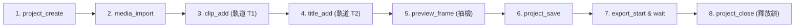

# YouTube & Facebook 旗艦解說動畫全能工坊 (`youtube-motion-explainer-studio`)

## 1. Overview (核心定位與雙模式架構)

本技能將「深度考證解說動畫（HyperFrames 1080p）」、「YouTube 高點擊率縮圖＋SEO 上架包」及「Facebook 高互動貼文包」整合為一條零斷點、抗報錯、可完全重複執行的端到端全自動生產線。

全能工坊支援**六大核心視覺與工作流模組**：
1. **模式 A：現代科技與巨頭商戰「真人實況模式」（Live-Action & Real Person Realism）**：
   - 嚴格遵守「**我要是真人**」原則：100% 紀實超寫實電影感風格，杜絕二次元、日漫或卡通風格。
   - 涵蓋真實科技領袖（黃仁勳、馬斯克、奧特曼等）發表會特寫、經典著裝（如招牌黑皮衣）、航太近地軌道衛星、半導體無塵室工程師、發射台點火與戰情室全景。
   - 整合豐富動態視覺組件：舞台立體光暈、雷射雷達掃描線、HUD 戰術四角框線、數據收縮光條、價格暴跌刪除線、粒子擊中翻轉震顫與熱輻射呼吸波。
2. **模式 B：歷史文獻與軍事戰役「史料紀實模式」（Historical Archive Mode）**：
   - 涵蓋多方戰史公報交叉考證、Wikimedia Commons 開放授權史料、紙本軍圖三色雙色調（Duotone）、動態軍事標記與 Google Colab G4 MiniMax H3 實景影片。
3. **模式 C：航太深空與硬核科學「實況＋代碼動態圖解混合流」（Real-Footage & Code-Driven Motion Pipeline）**：
   - **公有領域真實素材自動抓取**：Python 自動調用 NASA Image & Video Library 官方 API，批量下載真實發射與探測實拍（CC0 / Public Domain）。
   - **靜態照片 Ken Burns 緩慢推鏡**：透過 FFmpeg `zoompan` 賦予靜態歷史/新聞大圖流暢的電影級慢速推進運鏡。
   - **動態圖解代碼現場渲染**：針對微重力流體沉底（Ullage Thrust）、軌道力學對接等難以實拍的硬核原理，由 Antigravity 現場編寫 HTML5 Canvas 互動模擬器或 Python 渲染 1080p 粒子動畫。
   - **全自動無剪輯軟體串接 (FFmpeg Concat)**：純程式碼將實拍推鏡、概念圖解、自製物理粒子動畫與尾聲大景平滑無縫串接並燒錄中文字幕。
   - **封面頁雙軌機制與黃金 5 幕無重複敘事**：時間軸片頭封面卡 + MP4 容器海報中繼資料（`attached_pic`），拒絕結尾重複素材審美疲勞。
   - **16:9 爆款縮圖幾何動態置中與零缺字 (Zero-Tofu)**：Pillow `textbbox` 動態邊界計算，杜絕文字溢出框線，純淨文字排版避免 `□` 缺字方塊。
4. **模組 D：專業剪輯軟體「Concat MCP 自動化後製字卡與輸出管線」（Concat MCP Automated NLE Pipeline）**：
   - **完全無頭（Headless）自動化剪輯**：調用本機 Concat 剪輯軟體原生 MCP 服務，免手動開啟 GUI 即可完成專案建立、影片匯入、多軌編排與文字動態配置。
   - **黃金 6 大字卡矩陣（6-Card Arc）**：精準依據腳本時間軸植入「片頭懸念勾子、物理反差轉折、領袖登場特寫、商業模式定價權、終局制空權、片尾昇華與社群行動（CTA）」。
   - **空間分層防撞車原則（Upper-Third Rule）**：字卡統一配置於上三分之一（`offsetY: -0.34`），與底部解說字幕（`offsetY: +0.38`）完美分層，互不干擾。
   - **實時影格預覽校驗（Frame Preview）**：匯出前調用 `preview_frame` 抽取片頭、高潮、片尾之合成 PNG，核實構圖、色彩對比度與行距。
   - **背景非同步編碼與安全釋放專案鎖**：`export_start` + `export_wait` 輪詢渲染 1080p 30fps 高畫質成片（`renders/video_with_titles.mp4`），並透過 `project_close` 安全釋放 `concat.lock`。
5. **模式 E：全動態 B-roll 科技新聞播報流（Dynamic B-roll & Host HUD News Pipeline）**：
   - **動態 B-roll 視訊循環底圖（Dynamic B-roll Footage）**：以真實 1080p 高清動態影片為全幕背景（如資料中心機房伺服器指示燈、半導體無塵室晶圓傳輸、近地軌道衛星巡航、高能閃電風暴），透過 FFmpeg `-stream_loop -1` 實現分秒精確的無縫無黑畫面循環；上方疊加 80% 穿透率深海藍半透明玻璃資訊卡（`rgba(12, 19, 36, 210)`），營造強大電視新聞級科技景深。
   - **真人/虛擬角色主播 HUD 徽章（Host Avatar HUD Badge）**：精準擷取人物設定圖正面肖像，以 Pillow 圓形遮罩裁切，封裝進 260x300 賽博龐克 HUD 徽章，包含外層雙軌霓虹光環（Cyber Cyan `#00d2ff` & Tech Blue `#0055ff`）、頂部 `🟢 LIVE` 動態信標與底部身分銘牌（如 `科技總編 ｜ 深度觀點`），固定於右上角（`x=1560, y=45`），安全不擋標題與字幕。
   - **廣播級 Deep Tech 側鏈音訊避讓（BGM Ducking via Native FFmpeg Sidechain Compression）**：拒絕單調無感正弦波，搭載 124 BPM 實體 Deep Tech 合成器律動音軌（Audible kicks, snares & tech plucks）；透過原生 FFmpeg 側鏈壓縮器，人聲口播時 BGM 精準下潛至 `0.22` (-13dB)，人聲停頓時 350ms 平滑抬升至 `0.65`，搭配總輸出 +8.3dB 增益，符合 EBU R128 `-14.0 LUFS` 廣播級聽覺盛宴。
   - **幾何居中排版與左右對稱膠囊（Centered Typography & Symmetric Badges）**：標題大卡片與主次標題嚴格幾何居中（`card_cx = 795`），標籤膠囊採用動態 `textbbox` 計算左右對稱 Padding（`pad_x = 24`，`pill_w = text_w + 48`），杜絕偏向或溢出。
6. **模式 F：政策法案與時事新聞自動化調研流（Policy News, Legislation & Tweet Pipeline）**：
   - **Antigravity (Gemini) 聯網深度調研與分鏡 JSON 規範**：自動聯網檢索各國國會法案（如 Congress.gov、GPO 官方全文）、行政命令、巨頭政策白皮書（Meta/OpenAI）與關鍵人物選後發言（X/Twitter），提煉算力門檻（如 $10^{25}$ FLOPs）、法律罰則、產業界應對與對台灣供應鏈之影響，標準化輸出結構化 `storyboard.json`。
   - **Pexels API / Pixabay 自動化商用 B-roll 檢索與下載管線**：Python 自動根據分鏡關鍵詞（如 `datacenter`, `capitol congress`, `artificial intelligence code`）批次查詢 Pexels / Pixabay API，過濾下載 1080p 橫式免版稅高清短片至 `assets/broll/`，並自動記錄中繼清單 `broll_manifest.json`。
   - **Playwright / Chrome 無頭推文與法案文件焦點截圖管線**：以高解析度（2x Retina）無頭 Chromium 自動載入社群推文（X/Twitter）、政府公報 PDF/HTML 與新聞重點，自動注入深色模式與 CSS Selector 裁切，輸出無水印、高對比的透明/深色 PNG 卡片，直接作為分鏡疊加圖層（Overlay）。

全套流程固定配置：
- **旁白聲線**：繁體中文台灣國語神經語音（`zh-TW-YunJheNeural`）。
- **字型鎖定**：開源粗黑體首選源石黑體（`GenSekiGothic2TW-B.otf`）與 `NotoSansTC`。
- **音訊響度**：EBU R128 標準精準校準至 **`-14.0 LUFS`**（±0.3 LU，真峰值 `-0.9 dBFS` ~ `-1.2 dBFS`）。
- **交付包裝**：16:9 YouTube 爆款縮圖、`YOUTUBE_UPLOAD_PACK.md`、`FACEBOOK_POST_PACK.md`、`renders/video_with_titles.mp4` 與 `delivery_report.md`。

---

## 2. Dependencies & Ecosystem (既有技能編排)

本技能深度調度以下底層工具，請優先呼叫既有腳本，不重複造輪子：
- **`Antigravity / Gemini Web Search`**：即時聯網檢索法案資料庫（Congress.gov / GPO）、科技巨頭政策動向（OpenAI Blueprint / Meta）、X 即時貼文，提煉並輸出結構化分鏡 `storyboard.json`。
- **`Playwright` (Headless Chromium)**：精確無頭截取 X (Twitter) 推文、國會法案官方全文、新聞焦點，支援 2x Retina 解析度與深色模式注入。
- **`Pexels API` / `Pixabay API`**：自動化 1080p 橫式免版稅 B-roll 影片檢索與下載管線。
- **`concat-video-editor` / Concat MCP**：Concat 原生剪輯軟體 MCP 介面（`project_create`, `media_import`, `clip_add`, `title_add`, `clip_transform`, `preview_frame`, `export_start`, `export_wait`, `project_close`），實現專業 NLE 等級自動化字卡與成片輸出。
- **`motion-explainer-video`**：三色主題（`theme.py`）、字型統一（`unify_frames.py`）、字幕修補（`patch_captions.py`）、字型子集化（`subset_fonts.py`）、Colab H3 影片調度（`colab_h3.py`）。
- **`motion-explainer-images`**：開放授權圖片檢索（`web_image.py`）與雙色調處理（`duotone.py`）。
- **`faceless-explainer`**：時間軸字幕編譯（`captions.mjs`）、主畫面合成（`assemble-index.mjs`）、轉場注入（`transitions.mjs`）。
- **`motion-design`**：字級層次、留白比例與動態緩動曲線（Ease: `power3.out`, `back.out`）。
- **`review-loop`**：草稿全域時間軸節拍檢查表（`sheet.py`）與五重視覺品檢表。
- **`viral-thumbnail-designer`**：16:9 三分法構圖、兩行橘色粗體主標（≤10 字）＋雙數據對決卡。

---

## 3. Quick Start (核心 CLI 工具 `scripts/yt_studio_helper.py`)

本技能提供全功能、跨平台、強制 UTF-8 讀寫之 CLI 輔助工具 `scripts/yt_studio_helper.py`：

```powershell
# 1. 組裝後一鍵修復 CJK @font-face、captions 軌道標記、替換 repeat:-1，確保 hyperframes lint 0 error(s)
uv run "C:\Users\User\.gemini\config\skills\youtube-motion-explainer-studio\scripts\yt_studio_helper.py" fix-fonts-and-lint --project . --output renders/lint_status.json

# 2. 將渲染完成的 MP4 音訊無損校準至 -14.0 LUFS（影像軌 -c:v copy 100% 不重新編碼）
uv run "C:\Users\User\.gemini\config\skills\youtube-motion-explainer-studio\scripts\yt_studio_helper.py" normalize-audio --video renders/video.mp4 --target-lufs -14.0 --output renders/audio_loudness.json

# 3. UTF-8 安全合成 16:9 YouTube 爆款縮圖（暗角 Scrim + 橘色主標 + 白色副標 + 雙數據對決卡）
uv run "C:\Users\User\.gemini\config\skills\youtube-motion-explainer-studio\scripts\yt_studio_helper.py" build-thumbnail --bg assets/images/gen/youtube_thumbnail_bg.jpg --font assets/fonts/GenSekiGothic2TW-B.otf --config thumbnail_spec.json --output renders/youtube_thumbnail.jpg

# 4. 自動讀取 STORYBOARD.md 時間碼，一鍵生成 YouTube 上架包、Facebook 貼文包與專案交付報告
uv run "C:\Users\User\.gemini\config\skills\youtube-motion-explainer-studio\scripts\yt_studio_helper.py" generate-social-packs --project . --config social_spec.json --output social_pack_manifest.json

# 5. 自動探測成片長度與色調，生成 Concat 6 大字卡排程規劃 JSON（上三分之一安全帶 offsetY: -0.34）
uv run "C:\Users\User\.gemini\config\skills\youtube-motion-explainer-studio\scripts\yt_studio_helper.py" plan-concat-titles --project . --output concat_titles_plan.json

# 6. 安全解除 Concat 異常中斷殘留之專案鎖（concat.lock），防止多實例或下一次存取報錯
uv run "C:\Users\User\.gemini\config\skills\youtube-motion-explainer-studio\scripts\yt_studio_helper.py" unlock-concat --project .

# 7. 自動從人物/角色設定圖裁切正面人像，生成 260x300 賽博龐克主播 HUD 徽章（含 🟢 LIVE 呼吸燈與身分銘牌）
uv run "C:\Users\User\.gemini\config\skills\youtube-motion-explainer-studio\scripts\yt_studio_helper.py" build-avatar-badge --input assets/character_sheet.jpg --output renders/host_avatar_badge.png --label "科技總編 ｜ 深度觀點"

# 8. 廣播級側鏈音訊避讓（Deep Tech BGM 在口播時自動下潛至 0.22，無人聲時 350ms 平滑回彈至 0.65）
uv run "C:\Users\User\.gemini\config\skills\youtube-motion-explainer-studio\scripts\yt_studio_helper.py" sidechain-ducking --voice renders/full_narration.wav --bgm assets/audio/bgm_deep_tech.wav --output renders/master_ducked_audio.wav

# 9. 動態 B-roll 視訊無縫循環 (-stream_loop -1) 與半透明居中資訊卡合成
uv run "C:\Users\User\.gemini\config\skills\youtube-motion-explainer-studio\scripts\yt_studio_helper.py" compose-broll-scene --broll assets/broll/datacenter.mp4 --overlay cards/scene_1.png --duration 11.88 --output renders/scene_1.mp4

# 10. Pexels API / Pixabay 自動化下載 1080p 免版稅 B-roll 影片
uv run "C:\Users\User\.gemini\config\skills\youtube-motion-explainer-studio\scripts\yt_studio_helper.py" download-broll --query "datacenter server rack" --output assets/broll/datacenter.mp4 --source pexels

# 11. Playwright / Chrome 無頭高解析截取 X 推文、法案與新聞文件重點（深色模式 + 2x Retina）
uv run "C:\Users\User\.gemini\config\skills\youtube-motion-explainer-studio\scripts\yt_studio_helper.py" capture-web --url "https://x.com/RepYassAnsari/status/2118054336077127797" --selector "article[data-testid='tweet']" --dark-mode --output assets/snippets/tweet_ansari.png
```

---

## 4. End-to-End Workflow (8 階段標準流程)

### Phase 1: 專屬目錄隔離、多方考證與視覺人設鎖定
1. **建立專屬資料夾**：使用者指定的名稱（例如 `黃仁勳與輝達的商業棋局`），所有檔案、音訊、圖片與產出均嚴格限定於該目錄內，杜絕污染根目錄。
2. **多方考證與綱要撰寫**：
   - 撰寫 `BRIEF.md`：詳實考證物理定律（如史蒂芬-波茲曼定律）、工程規格（SEU、TMR、LHP、OISL）與法律條約（《外太空條約》第八條）。
   - 鎖定主題三色（`theme.json`，如 Cyber Lime `#76B900`、Space Amber `#FFA82E`、Dark Slate `#0A0E17`）。
3. **確認視覺方針**：
   - 若使用者明確提出「**我要是真人**」或屬於商業科技主題，直接啟動 **真人實況模式**，鎖定高擬真寫實影像。

### Phase 1.2: Antigravity 聯網深度調研與分鏡 JSON 規範 (Legislation & News Research to Storyboard JSON Pipeline)

當製作時事新聞、科技監管法案、政策重大變更或巨頭博弈主題時（例如美國《禁止人工超級智慧法案》S.5493 / H.R.10538、算力管制與出口禁令），由 Antigravity (Gemini) 自動化執行聯網調研並產出標準化、全自動管線可消費之 `storyboard.json`：

1. **多維度聯網檢索矩陣（Web Research Matrix）**：
   - **法案原文與國會進度**：檢索 Congress.gov 與 GPO 官方公報（辨識法案編號如 S.5493、H.R.10538，連署人黨派比例，以及法案卡在委員會或進入院會之實質狀態）。
   - **核心技術門檻與量化指標**：精確抽取關鍵技術指標（如訓練算力臨界點 $10^{25}$ FLOPs，對照 GPT-4、Gemini、Claude 是否超標）。
   - **處罰條款與法律後果**：釐清最重刑責（如 20 年監禁、從業禁令 10 年）與主觀要件（如「明知有風險仍違規開發 recklessly」）。
   - **科技巨頭選後 48 小時動態**：整理 WhiteHouse 官方協議、Meta 總裁建設聲明、OpenAI 全國社區協定與電網保護方案、馬斯克社群表態。
   - **台灣與供應鏈實質影響**：結合經濟部/財政部最新貿易出口數據（如資通訊出口佔比 79%），說明對台灣 AI 伺服器與硬體鏈的直接衝擊。

2. **全自動管線驅動核心：`storyboard.json` 結構規範**：
   Antigravity 自動將調研成果編譯為以下規格之 `storyboard.json`，供後續 Python 下載 B-roll、Playwright 網頁截圖、TTS 配音與 FFmpeg 自動合成：

```json
{
  "project_title": "美國會禁止超級 AI 嗎？國會提案與巨頭應對深度解析",
  "target_duration_sec": 180,
  "theme_colors": {
    "primary": "#FFA82E",
    "accent": "#00d2ff",
    "background": "#0A0E17",
    "alert": "#FF5555"
  },
  "scenes": [
    {
      "scene_id": "scene_01_hook",
      "chapter": "開場：藍潮之後，最重判 20 年的震撼提案",
      "duration_sec": 14.5,
      "narration": "美國期中選舉開票隔天，國會突然拋出一份震撼彈：任何訓練算力超過 10 的 25 次方的先進 AI，最重判刑 20 年！這份提案到底寫了什麼？科技巨頭又該如何應對？",
      "broll_queries": [
        "us capitol congress night",
        "datacenter server rack glow"
      ],
      "web_captures": [
        {
          "id": "tweet_ansari",
          "url": "https://x.com/RepYassAnsari/status/2118054336077127797",
          "selector": "article[data-testid='tweet']",
          "output": "assets/snippets/tweet_ansari.png",
          "dark_mode": true
        }
      ],
      "title_card": {
        "text": "【最重判 20 年】\\n國會震撼提案・全面暫停先進 AI？",
        "offsetY": -0.34,
        "color": "#FFA82E",
        "fontSize": 0.048
      }
    },
    {
      "scene_id": "scene_02_bill_text",
      "chapter": "條文拆解：10 的 25 次方到底管誰？",
      "duration_sec": 18.0,
      "narration": "翻開法案全文，關鍵門檻鎖定在 10 的 25 次方次運算。這條線有多嚴格？Epoch AI 估計 GPT-4 訓練約 2.1 乘 10 的 25 次方；也就是說，市面上的主力模型幾乎全數踩線！",
      "broll_queries": [
        "artificial intelligence chip macro",
        "glowing circuit board data"
      ],
      "web_captures": [
        {
          "id": "gpo_bill_pdf",
          "url": "https://www.govinfo.gov/content/pkg/BILLS-119hr10538ih/pdf/BILLS-119hr10538ih.pdf",
          "selector": "body",
          "output": "assets/snippets/gpo_bill.png",
          "dark_mode": false
        }
      ],
      "title_card": {
        "text": "【精確條文門檻】\\n10^25 FLOPs 算力紅線・主流模型全數踩雷！",
        "offsetY": -0.34,
        "color": "#FF5555",
        "fontSize": 0.045
      }
    }
  ]
}
```

3. **雙向同步與資產預檢**：
   - 產出 `storyboard.json` 後，自動同步更新 `STORYBOARD.md` 與 `BRIEF.md`。
   - 驗證每幕所需 B-roll 關鍵字與網頁截圖 URL 是否齊全，確保後續階段 100% 零斷點執行。

### Phase 2: 台灣國語旁白合成與時間碼精確同步
1. 撰寫 8 幕分鏡腳本 `SCRIPT.md` 與 `STORYBOARD.md`（總長約 130–160 秒）。
2. 調用 TTS 生成 `assets/voice/raw/01.wav` ~ `08.wav`（`zh-TW-YunJheNeural`）。
3. 執行靜音修剪，產出 `audio_meta.json`。確認每幕子句秒數精確記錄，並回寫至 `STORYBOARD.md`。
4. 使用 ffmpeg 合成完整旁白母帶音軌 `renders/full_narration.wav` 與試聽音檔 `renders/full_narration.mp3`。

### Phase 3: 寫實視覺資產庫與「多裁切宏觀提煉法（Macro Crop Pipeline）」
當需要真人實況照片（如黃仁勳發表會特寫、近地軌道衛星、蜂巢散熱翼板、太空站觀景艙）時：
1. **生成 4K/8K 核心主視覺大圖**：存為 `assets/images/gen/youtube_thumbnail_bg.jpg`。
2. **多裁切提煉法（解決 API 429 額度與特定模式限制）**：
   - 透過 Python Pillow 以最高品質 Lanczos 演算法從高解析度主大圖進行精準局部裁切：
     - **人物近景特寫**：裁切提煉黃仁勳演講特寫（`jensen_huang_keynote_spotlight.jpg`）。
     - **微觀核心模組**：裁切提煉石墨烯散熱翼板與熱管細節（`orbital_radiator_macro.jpg`）。
     - **宏觀環境全景**：裁切提煉星艦軌道與地球曲率（`earth_orbital_edge.jpg`）。
     - **終局戰略構圖**：裁切提煉太空站觀景艙俯瞰星際算力（`jensen_observation_deck.jpg`）。
3. **相對路徑防呆**：Sub-composition（`compositions/frames/*.html`）引用圖片時，統一使用相對路徑 `../../assets/images/gen/<filename>`。

### Phase 3.2: 公有領域真實素材自動抓取管線 (NASA & Wikimedia CC0 Open Asset Pipeline)
當製作航太、天體物理或重大歷史事件時，優先調用官方公有領域真實資產（高客觀性與權威感）：
1. **NASA 官方 API 批量檢索下載**：
   - 調用 NASA Image and Video Library 官方 API（`https://images-api.nasa.gov/search`），輸入關鍵字（如 `Artemis I launch`、`Starship HLS`、`Orion Earth orbit`）。
   - 取得原始高解析度影像與影片鏈接，自動儲存至專案 `assets_open/` 目錄。
2. **Wikimedia Commons 開放授權圖庫（SpaceX Flickr CC0）**：
   - 若 NASA 圖庫缺乏特定商業火箭最新活動（如 Starship IFT-5 點火、筷子回收實景），改由 Python 呼叫 Wikimedia Commons API（`https://commons.wikimedia.org/w/api.php?action=query&generator=search&gsrsearch=SpaceX+Starship&gsrnamespace=6`）。
   - 提取 SpaceX 官方以 CC0 / Public Domain 釋出的原廠數千像素級實拍（如 IFT-5 33 具猛禽發動機點火騰空、B12 助推器網格舵特寫）。
3. **自動建立資產清單與授權核對**：
   - 自動生成 `nasa_assets_manifest.json`，記錄每個資產的 ID、標題、說明、原始來源網址與授權說明（NASA Public Domain / CC0，免費商業與非商業教學使用），以供影片資訊欄與版權合規審查。

### Phase 3.3: 真人/角色主播 HUD 徽章自動生成管線 (Host Avatar HUD Badge Pipeline)

當使用者要求「加入真人主播」、「主播角色 HUD」、「科技主播視窗」時，啟動此標準化主播頭像徽章生成管線：

1. **正面肖像精準擷取與抗鋸齒圓形裁切**：
   - 讀取使用者指定的角色設定圖（例如三視圖、人物形象卡）或真實人物照片。
   - 鎖定正面臉部與微笑上半身區域（以人臉幾何中心為軸心進行正方形 Crop）。
   - 透過 Pillow 建立抗鋸齒 Alpha 遮罩（直徑 190px），將方形肖像裁切為純淨圓形頭像。

2. **賽博霓虹雙軌光環與全息 HUD 刻度**：
   - 在圓形頭像外圍繪製雙層同心圓環：
     - 內層光環：直徑 198px，線寬 3px，高亮賽博青（Cyber Cyan `#00d2ff`）。
     - 外層光環：直徑 206px，線寬 2px，深邃科技藍（Tech Blue `#0055ff`，透明度 80%）。
   - 於光環 45°、135°、225°、315° 繪製 HUD 戰術刻度角線，營造全息懸浮科技儀表感。

3. **頂部 `🟢 LIVE` 動態信標與底部身分銘牌（Status Beacon & Identity Pill）**：
   - **頂部 `🟢 LIVE` 指示燈**：於徽章頂部中心（`y=10`）繪製深色圓角膠囊（`rgba(10, 20, 35, 230)`），左側嵌入鮮綠色發光呼吸信標（`#00ff66`），右側文字標註 `LIVE`。
   - **底部身分銘牌（Identity Pill）**：於徽章底部（`y=220`）繪製深藍黑圓角膠囊，邊框為高亮青色，內部嵌入專業頭銜（如 `科技總編 ｜ 深度觀點`），文字使用 `textbbox` 動態居中對齊。

4. **右上角黃金安全區（Upper-Right Safe Placement）**：
   - 徽章規格固定為 `260 x 300` 透明 PNG，合成至主畫面時錨定於右上角：
     - `x = 1560, y = 45`
   - **零衝突空間分層**：左側大標題卡寬度嚴格限制在 `w=1410`（`x=90..1500`），與徽章保持 60px 呼吸間距；底部留空給字幕軌道，保證多元素共存時層次清晰、互不遮擋。

```python
# 主播 HUD 徽章標準生成程式碼範例
from PIL import Image, ImageDraw, ImageFont

def create_host_avatar_badge(face_img, label_text="科技總編 ｜ 深度觀點", status="LIVE", font_pill=None, font_small=None):
    W, H = 260, 300
    badge = Image.new("RGBA", (W, H), (0, 0, 0, 0))
    draw = ImageDraw.Draw(badge)
    cx, cy = W // 2, 120
    
    # 1. 圓形裁切肖像 (直徑 190)
    face_resized = face_img.resize((190, 190), Image.Resampling.LANCZOS).convert("RGBA")
    mask = Image.new("L", (190, 190), 0)
    ImageDraw.Draw(mask).ellipse((0, 0, 190, 190), fill=255)
    badge.paste(face_resized, (cx - 95, cy - 95), mask)
    
    # 2. 雙層科技霓虹光環
    draw.ellipse([cx - 99, cy - 99, cx + 99, cy + 99], outline=(0, 210, 255, 255), width=3)
    draw.ellipse([cx - 103, cy - 103, cx + 103, cy + 103], outline=(0, 85, 255, 200), width=2)
    
    # 3. 頂部 LIVE 膠囊信標
    draw.rounded_rectangle([cx - 40, 10, cx + 40, 32], radius=11, fill=(10, 20, 35, 235), outline=(0, 210, 255, 180), width=1)
    draw.ellipse([cx - 28, 17, cx - 18, 27], fill=(0, 255, 100, 255))
    draw.text((cx - 12, 12), status, fill=(255, 255, 255, 255), font=font_small)
    
    # 4. 底部身分銘牌 (左右對稱居中)
    bbox = draw.textbbox((0, 0), label_text, font=font_pill) if font_pill else (0, 0, 160, 20)
    tw = bbox[2] - bbox[0]
    pill_w = max(200, tw + 40)
    draw.rounded_rectangle([cx - pill_w // 2, 222, cx + pill_w // 2, 256], radius=10, fill=(12, 19, 36, 240), outline=(0, 210, 255, 240), width=2)
    draw.text((cx - tw // 2, 226), label_text, fill=(0, 210, 255, 255), font=font_pill)
    return badge
```

### Phase 3.4: Pexels API / Pixabay 自動化商用 B-roll 檢索與下載管線 (Automated Stock Video Pipeline)

在科技新聞解說中，高質量的真實背景動態影片（B-roll）是營造電視級景深的關鍵核心（如資料中心伺服器綠光閃爍、晶圓傳輸機械手臂、國會大廈夜景、光纖流光）。本管線支援全自動檢索與下載：

1. **多來源自動化過濾與檢索**：
   - 讀取 `storyboard.json` 中每幕設定的 `broll_queries`（如 `datacenter server rack glow`、`us capitol congress night`）。
   - 自動調用 `scripts/yt_studio_helper.py download-broll`：
     - **Pexels API**（預設）：`https://api.pexels.com/videos/search?query=...&orientation=landscape&per_page=5`
     - **Pixabay API**（備援）：`https://pixabay.com/api/videos/?key=...&q=...&video_type=film`
   - **嚴格解析度過濾**：自動解析 API 回傳之 `video_files`，優先鎖定寬度 `1920`（1080p）或更高解析度之橫式 MP4，杜絕 720p 或直式短片。
2. **自動下載與 `broll_manifest.json` 授權登記**：
   - 影片檔案自動下載並儲存至專案目錄 `assets/broll/<scene_id>.mp4`。
   - 自動建立 `assets/broll/broll_manifest.json`，記錄每個分鏡素材來源、攝影師名稱、原始網址與授權（Pexels License / Pixabay License，允許商用無版權爭議），供影片說明欄 Credits 引用。
3. **CLI 呼叫範例**：
   ```powershell
   # 使用 Pexels API 下載機房伺服器 B-roll
   uv run "C:\Users\User\.gemini\config\skills\youtube-motion-explainer-studio\scripts\yt_studio_helper.py" download-broll --query "datacenter server rack" --output assets/broll/scene_01.mp4 --source pexels
   
   # 使用 Pixabay API 下載國會山莊 B-roll
   uv run "C:\Users\User\.gemini\config\skills\youtube-motion-explainer-studio\scripts\yt_studio_helper.py" download-broll --query "capitol congress" --output assets/broll/scene_02.mp4 --source pixabay
   ```

### Phase 3.5: Playwright / Chrome 無頭網頁推文與法案文件焦點截圖管線 (Playwright Headless Snippet Pipeline)

時事新聞與政策解說最強調「有圖有真相」。透過無頭 Chromium，Antigravity 可自動化前往關鍵網頁精準擷取高解析、深色模式的社群推文卡片與法案條文切片：

1. **社群推文 (X / Twitter) 高清卡片截取**：
   - 針對議員貼文、馬斯克回應、官方 X 公告（如 `@RepYassAnsari`、`@WhiteHouse`、`@elonmusk`）：
   - 自動啟動 Playwright 無頭瀏覽器，設定 `device_scale_factor: 2`（2x Retina 像素密度，字體與頭像極致清晰）。
   - 注入深色模式（`color_scheme="dark"`），與科技新聞深海藍/深空黑主題完美融合。
   - **精準 CSS Selector 裁切**：透過 `article[data-testid="tweet"]` 僅截取推文主卡片本身，自動剔除外圍的網頁導航列、側邊欄廣告與無關留言。
2. **國會法案官方公報 (GPO / Congress.gov) 與巨頭白皮書重點條文截取**：
   - 載入 GPO 法案官方 PDF/HTML 條文（如 H.R.10538、S.5493）或 OpenAI 基礎建設白皮書。
   - 自動等待動態渲染完成，精準定位條文段落（如罰則「shall be imprisoned not more than 20 years」、門檻「10^25 FLOPs」）。
   - 產出乾淨清晰的 1080p/4K 等級 PNG 圖卡，儲存於 `assets/snippets/`。
3. **CLI 呼叫範例**：
   ```powershell
   # 截取 X (Twitter) 推文卡片 (深色模式 + 2x 銳利度)
   uv run "C:\Users\User\.gemini\config\skills\youtube-motion-explainer-studio\scripts\yt_studio_helper.py" capture-web --url "https://x.com/RepYassAnsari/status/2118054336077127797" --selector "article[data-testid='tweet']" --dark-mode --output assets/snippets/tweet_ansari.png
   
   # 截取國會法案重點條文頁面
   uv run "C:\Users\User\.gemini\config\skills\youtube-motion-explainer-studio\scripts\yt_studio_helper.py" capture-web --url "https://www.congress.gov/bill/119th-congress/house-bill/10538" --selector ".featured-bill" --output assets/snippets/bill_summary.png
   ```
4. **分鏡無縫疊加**：
   - 截取之 PNG 圖卡可直接代入 `Phase 7.4` 的資訊卡圖層，或是透過 Pillow 繪製 80% 穿透率深海藍底卡與青色邊框，置中疊加於動態 B-roll 視訊之上。

### Phase 4: 高級動態視覺組件庫 (Rich Motion Design Components)
為了滿足「**增加多一點動畫、以畫面的動畫最漂亮為主**」的要求，每幕 HTML 應採用以下專業 GSAP 組件：

1. **攝影棚立體光暈與名牌語錄 (Volumetric Spotlight & Speaker Banner)**：
   - 用於真實人物登場，搭配半透明玻璃名牌（Glassmorphism Banner）、演說語錄發光浮現與緩動推鏡（Ken Burns zoom `scale: 1.08`）。
2. **硬體加速雷射雷達掃描線 (Laser Radar Scanline)**：
   - 太空衛星或高科技硬體上方配置掃描線，使用 GSAP `y: 0 -> max`，設置有限次數 `repeat: 4`，配合半透明發光陰影。
3. **戰術 HUD 四角框線與即時遙測標籤 (Tactical Brackets & Telemetry Badges)**：
   - 圖片四角疊加戰術框線（`.corner-bracket`），左上角配置綠色/琥珀色呼吸點（`animation: pulse`）與即時遙測文字（`ORBITAL TELEMETRY // ALT: 500.4 KM`）。
4. **動態數據收縮光條 (Data Shrink Bar)**：
   - 呈現傳輸負擔銳減（如 -90%），使用雙色漸層光條，透過 `scaleX: 1 -> 0.1`（`transform-origin: left center`）動態收縮，呈現視覺震撼。
5. **動態刪除線與價格暴跌對決 (Strikethrough Price Drop)**：
   - 成本從舊數字暴跌至新數字時，舊數字動畫劃上刪除線並降低透明度，新數字以 `back.out(1.6)` 彈跳放大高亮。
6. **微觀高能粒子翻轉震顫 (SEU Bit-Flip Shake)**：
   - 單粒子翻轉（`0 ➔ 1`）時，位元 1 爆發紅色霓虹光暈，卡片容器執行微震動（`x: -4, repeat: 4, yoyo: true`）。
7. **熱輻射呼吸波 (Thermal Heatwave Wave)**：
   - 散熱工程畫面使用徑向漸層覆蓋層，以 `scale: 0.95 -> 1.05` 與 `opacity: 0.3 -> 0.85` 呈現熱能輻射散逸。

### Phase 4.2: 核心物理與動態圖解代碼現場渲染 (Physics & Code-Driven Motion Graphics)
對於無法實拍的科學機理（如微重力失重流體、沉底推力 Ullage Thrust、星艦尾部對接、半導體光刻），直接由 Antigravity 透過程式碼現場渲染：
1. **互動式物理模擬器（HTML5 Canvas）**：
   - 建立獨立互動網頁（如 `ullage_thrust_simulation.html`），模擬 160+ 顆液氧/液甲烷低溫流體粒子在微重力下的飄散布朗運動與沉底推力點火後的穩態下沉過程。
   - 整合即時遙測 HUD：顯示加速度、渦輪泵氣蝕風險百分比（Cavitation Risk）、閥門閉鎖與傳輸速率。
2. **純程式碼 1080p 實體視訊渲染（Python + Pillow + FFmpeg）**：
   - 撰寫生成腳本（如 `render_ullage_clip.py`），利用 Python 現場計算每幀物理粒子座標與賽博龐克風格 HUD，並透過管道直接餵給 FFmpeg 串流輸出 1080p 30fps 無損 MP4 動畫片段（如 `ullage_thrust_1080p.mp4`），隨時可無縫作為 B-Roll 拼入主時間軸。

### Phase 5: 8 幕 HTML/GSAP 組裝與「五大嚴格 Lint 規範」
執行以下組裝流程：
`captions.mjs build` ➔ `assemble-index.mjs` ➔ `transitions.mjs inject` ➔ 呼叫 `yt_studio_helper.py fix-fonts-and-lint`。

> [!IMPORTANT]
> **五大 GSAP 嚴格 Lint 守則（違反將導致 hyperframes lint 失敗，無法渲染）：**
> 1. **嚴格禁用 `repeat: -1`**：HyperFrames 畫面必須能有限終止。任何持續循環動畫一律改用有限次數（如 `repeat: 4` 或 `repeat: 8`），並確保總時長不超過該幕 duration。
> 2. **嚴格禁用非 Transform 屬性動畫**：禁止對 `top`、`left`、`width`、`height` 設定 GSAP 動畫（會觸發 `gsap_non_transform_motion`）。一律改用 `x`、`y`、`scale`、`scaleX`、`rotation` 與 `opacity`。
> 3. **字幕容器必須標註軌道種類**：`<div id="el-captions">` 必須加上 `data-track-kind="captions"`，否則觸發 `caption_track_kind_missing`。
> 4. **字型宣告必須 100% 完整對應**：CSS 內有出現的字型名稱（包含 `Hanken Grotesk`、`NotoSansTC`、`NotoSerifTC`、`GenSekiGothic`），均必須在 `<style>` 中有明確的 `@font-face` 宣告（可使用 `local('Arial')` 作 fallback），否則觸發 `font_family_without_font_face`。
> 5. **DOM ID 嚴禁數字開頭**：所有 DOM id 必須英文字母開頭（如 `id="cardHook"`，嚴禁 `id="01-hook"`），避免 CSS 轉義錯誤。

### Phase 6: 快速多工草稿渲染與視覺自我審查 (Review Loop)
1. **多工草稿渲染（速度提升 3 倍）**：
   ```powershell
   cmd /c hyperframes render --quality draft --fps 4 --workers 2 --output renders/draft.mp4
   ```
2. **全域時間軸節拍擷取**：
   使用 `review-loop/scripts/sheet.py`，傳入全片 8 幕之絕對時間秒數（例如 `"5.0,24.0,48.0,64.0,82.0,102.0,118.0,135.0"`）產出 `renders/contact_sheet.jpg/beats-1.png`。
3. **逐張畫面檢視確認**：
   使用 `read_file` 檢視各幕截圖，確認真人特寫清晰、排版無文字溢出、動態標籤對齊。

### Phase 7: 30fps 正式渲染與 EBU R128 音訊無損標準化
1. 輸出正式影片 `renders/video.mp4`。
2. 執行 `yt_studio_helper.py normalize-audio`：
   - 整合響度校準至 `-14.0 LUFS`（±0.3 LU）。
   - 音訊濾鏡：`volume=<gain>dB,alimiter=limit=-1.2dB:level=false`。
   - 視訊參數：`-c:v copy`（完全不重編碼視訊畫面，零畫質損失、超高速）。

### Phase 7.2: 全程式碼多段分鏡平滑串接與封面雙軌合成 (FFmpeg Concat, Zoompan & Cover Pipeline)
當使用者明確要求**「不開任何剪輯軟體，純程式碼一鍵直出成片」**時，啟動此純代碼合成流水線：

1. **拒絕視覺疲勞：黃金 5 幕非重複敘事弧線 (5-Scene Anti-Fatigue Arc)**：
   - 短影音（60–90s）每個分鏡嚴格使用**獨立且不重複**的視覺資產，杜絕結尾重新使用開場圖片的單調感：
     - **Scene 0A（封面片頭卡，0-6s，180 幀）**：16:9 YouTube 縮圖以極緩速推鏡（`z='min(zoom+0.00015,1.06)'`）登場，配合開場劇名口播，第 1 秒建立爆款視覺基調。
     - **Scene 0B（宏觀大景，6-20s，420 幀）**：NASA / 官方實拍發射塔或太空站宏觀全景（建立真實空間尺度）。
     - **Scene 1（微觀特寫，20-38s，540 幀）**：硬體細節特寫，引出痛點或破局難題（如 4mm 不鏽鋼薄殼一夾就爆）。
     - **Scene 2（代碼物理圖解，38-65s，810 幀）**：自研 Canvas / Python HUD 粒子動態模擬（展示懸停搭接、液壓減震等核心機理）。
     - **Scene 3（全新震撼高潮，65-78s，375 幀）**：**非重複的全新大景**（如 Starship IFT-5 任務 33 具猛禽發動機萬噸烈焰點火升空、入軌噴氣），將情緒推向「人類太空探索工程奇蹟」最高峰！

2. **靜態照片動態化（Ken Burns 緩慢推鏡）**：
   - 透過 FFmpeg `zoompan` 濾鏡讓實拍照片呈現紀錄片般的慢速推進鏡頭，徹底消除呆板感：
     ```bash
     scale=3840:2160:force_original_aspect_ratio=increase,crop=3840:2160,zoompan=z='min(zoom+0.0004,1.25)':x='(iw-iw/zoom)/2':y='(ih-ih/zoom)/2':d=420:s=1920x1080:fps=30
     ```

3. **封面頁雙軌機制（Timeline Opening Card + MP4 Attached Picture Metadata）**：
   - **Step 1：時間軸片頭封面卡**：透過 `concat=n=5:v=1:a=0` 將 16:9 縮圖作為 Scene 0A 融入影片開頭，末端燒錄高對比中文字幕：
     ```python
     cmd1 = [
         "ffmpeg", "-y",
         "-i", "renders/youtube_thumbnail.jpg",          # 0: 封面片頭 (d=180, 6s)
         "-i", "assets_open/tower_wide.jpg",             # 1: 宏觀大景 (d=420, 14s)
         "-i", "assets_open/booster_parts.jpg",          # 2: 部件特寫 (d=540, 18s)
         "-stream_loop", "4", "-i", "visuals/anim.mp4",  # 3: 自製物理圖解 (27s)
         "-i", "assets_open/starship_ignition.jpg",      # 4: 全新非重複高潮 (d=375, 12.5s)
         "-i", "audio/narration.mp3",                    # 5: 旁白 (77.5s)
         "-filter_complex", (
             "[0:v]scale=3840:2160:force_original_aspect_ratio=increase,crop=3840:2160,zoompan=z='min(zoom+0.00015,1.06)':x='(iw-iw/zoom)/2':y='(ih-ih/zoom)/2':d=180:s=1920x1080:fps=30,format=yuv420p[v0a];"
             "[1:v]scale=3840:2160:force_original_aspect_ratio=increase,crop=3840:2160,zoompan=z='min(zoom+0.0004,1.25)':x='(iw-iw/zoom)/2':y='(ih-ih/zoom)/2':d=420:s=1920x1080:fps=30,format=yuv420p[v0b];"
             "[2:v]scale=3840:2160:force_original_aspect_ratio=increase,crop=3840:2160,zoompan=z='min(zoom+0.0003,1.2)':x='(iw-iw/zoom)/2':y='(ih-ih/zoom)*(on/540)':d=540:s=1920x1080:fps=30,format=yuv420p[v1];"
             "[3:v]trim=duration=27,setpts=PTS-STARTPTS,fps=30,scale=1920:1080:force_original_aspect_ratio=decrease,pad=1920:1080:(ow-iw)/2:(oh-ih)/2,format=yuv420p[v2];"
             "[4:v]scale=3840:2160:force_original_aspect_ratio=increase,crop=3840:2160,zoompan=z='min(zoom+0.00025,1.18)':x='(iw-iw/zoom)/2':y='(ih-ih/zoom)*(1-0.45*on/375)':d=375:s=1920x1080:fps=30,format=yuv420p[v3];"
             "[v0a][v0b][v1][v2][v3]concat=n=5:v=1:a=0[vcat];"
             f"[vcat]subtitles='{srt_path}':force_style='FontName=Microsoft JhengHei,FontSize=22,PrimaryColour=&H0000FFFF,OutlineColour=&H00000000,BorderStyle=1,Outline=2,Shadow=1,Alignment=2,MarginV=35'[vfinal]"
         ),
         "-map", "[vfinal]", "-map", "5:a",
         "-c:v", "libx264", "-preset", "fast", "-crf", "18", "-pix_fmt", "yuv420p",
         "-c:a", "aac", "-b:a", "192k", "-shortest", "renders/final_video_temp.mp4"
     ]
     ```
   - **Step 2：內嵌 MP4 容器級海報（Attached Picture）**：
     ```bash
     ffmpeg -y -i renders/final_video_temp.mp4 -i renders/youtube_thumbnail.jpg -map 0 -map 1 -c copy -disposition:v:1 attached_pic renders/final_video.mp4
     ```
     使 Windows 檔案總管、macOS Finder、通訊軟體（Line/Telegram）與播放器第一時間直接顯示 16:9 封面海報！

### Phase 7.3: Concat MCP 自動化後製字卡與成片輸出管線 (Concat MCP Automated Title Cards & Post-Production Pipeline)

當使用者要求**「幫我加片頭與片尾字卡」、「看一下哪些地方需要加字卡」、「自動使用 Concat 剪輯軟體透過 Concat MCP 加上字卡並直接輸出」**時，啟動 Concat MCP 自動化後製管線。

本管線完全由 AI 透過 JSON-RPC 控制本機 Concat 剪輯軟體，不需要手動開啟 GUI，全自動完成多軌配置、精準字卡排程、空間安全分層、實時影格抽檢與 1080p 背景編碼：

#### 1. 空間分層防撞車原則（Upper-Third Safe Zone Rule）
在專業解說影片中，視覺元素必須嚴格分層，避免字卡與解說字幕相互覆蓋：
- **下三分之一（`offsetY: +0.35` ~ `+0.42`）**：保留給語音同步字幕（Captions Track）。
- **頂部邊緣（`offsetY: -0.45` ~ `-0.48`）**：保留給極簡章節標記或微型 HUD 狀態指示。
- **字卡黃金安全帶（Upper-Third：`offsetY: -0.34`）**：
  所有轉折字卡一律配置於 `offsetY: -0.34`。此位置座落在主體人物頭部上方或宏觀背景的天際線空間，層次分明、氣勢磅礴，且 **100% 杜絕與底部解說字幕撞車**。

#### 2. 黃金 6 大字卡矩陣（The 6-Card Strategic Matrix）
根據觀眾專注力曲線與資訊層級，一部 2~3 分鐘旗艦解說片標準配置 6 組重點字卡：

| 序號 | 字卡類型 | 建議時序區間 | 視覺色彩推薦 | 建議字級 | 核心文案結構範例 |
| :--- | :--- | :--- | :--- | :--- | :--- |
| **01** | **片頭懸念勾子** | 0.5s – 5.5s | Space Amber `#FFA82E` | `0.052` | `黃仁勳與輝達的商業棋局\n直擊 500km 近地軌道星際超算` |
| **02** | **物理極限轉折** | 15s – 25s 區間 (約 4.5s) | Alert Red `#FF5555` | `0.045` | `【反直覺物理極限】\n太空中沒有空氣對流・晶片最大死穴是「真空熱死」！` |
| **03** | **領袖登場革命** | 60s – 75s 區間 (約 5.0s) | Cyber Lime `#76B900` | `0.045` | `【黃仁勳的星際棋局】\n我們不只賣晶片・更在賣星際資料中心互聯！` |
| **04** | **商業重構定價** | 100s – 115s 區間 (約 4.5s) | Space Amber `#FFA82E` | `0.045` | `【重構雲端經濟學】\n星艦發射成本暴跌至 <$200/kg・輝達掌握星際定價權！` |
| **05** | **數位飛地終局** | 120s – 130s 區間 (約 4.5s) | Cyber Lime `#76B900` | `0.045` | `【終局空天博弈】\n軌道算力數位飛地・二十一世紀空天防衛終極制空權！` |
| **06** | **片尾昇華行動** | 影片最後 6~8s 直至結尾 | Bright White `#FFFFFF` | `0.038` | `感謝收看・歡迎按讚訂閱分享\n誰掌握軌道算力，誰就主導下一個五十年的科技霸權！\n#NVIDIA #黃仁勳 #星際算力 #AI資料中心` |

> [!TIP]
> 片尾字卡通常包含 3 行文字（社群三連 + 核心哲理金句 + 話題標籤），字級應縮小至 `0.038`，行距自然收緊，避免過高遮擋結尾大景或演講者臉部。

#### 3. Concat MCP 8 步標準調用鏈 (Standard MCP Execution Chain)

透過 Antigravity 原生 `call_mcp_tool` 呼叫 `concat` 伺服器：



1. **`project_create` 建立工作專案**：
   ```json
   { "ServerName": "concat", "ToolName": "project_create", "Arguments": { "location": "<project_dir>", "name": "concat_edit_project" } }
   ```
2. **`media_import` 匯入原始成片**：
   ```json
   { "ServerName": "concat", "ToolName": "media_import", "Arguments": { "path": "<project_dir>/concat_edit_project", "file": "<project_dir>/renders/video.mp4" } }
   ```
   *回傳媒體識別碼 `createdId: "m1"` 與總時長（如 `duration: 141.76` 秒）。*
3. **`clip_add` 配置底層影片軌道**：
   ```json
   { "ServerName": "concat", "ToolName": "clip_add", "Arguments": { "path": "<project_dir>/concat_edit_project", "mediaId": "m1", "trackId": "T1", "start": 0.0 } }
   ```
4. **`title_add` 依序加入 6 大字卡（疊加於軌道 `T2`，設定 `above: true`）**：
   ```json
   {
     "ServerName": "concat",
     "ToolName": "title_add",
     "Arguments": {
       "path": "<project_dir>/concat_edit_project",
       "start": 0.5,
       "duration": 5.0,
       "above": true,
       "offsetY": -0.34,
       "style": {
         "content": "黃仁勳與輝達的商業棋局\\n直擊 500km 近地軌道星際超算",
         "fontSize": 0.052,
         "fontWeight": "bold",
         "color": "#FFA82E",
         "align": "center",
         "shadow": { "color": "rgba(0,0,0,0.85)", "blur": 12, "offsetX": 0, "offsetY": 3 }
       }
     }
   }
   ```
   *依序加入剩餘 5 組字卡。若需調整垂直偏移使用 `clip_transform(offsetY=-0.34)`；微調文字與樣式使用 `clip_update(patch={ text: ... })`。*
5. **`preview_frame` 關鍵影格即時抽檢**：
   ```json
   { "ServerName": "concat", "ToolName": "preview_frame", "Arguments": { "path": "<project_dir>/concat_edit_project", "time": 2.5, "output": "<project_dir>/preview_title_intro.png" } }
   ```
   *分別於片頭 (2.5s)、領袖演講 (70.0s)、片尾 (138.0s) 抽取真機渲染 PNG 進行視覺排版品檢。*
6. **`project_save` 儲存工程專案**：
   ```json
   { "ServerName": "concat", "ToolName": "project_save", "Arguments": { "path": "<project_dir>/concat_edit_project" } }
   ```
7. **`export_start` & `export_wait` 非同步編碼**：
   ```json
   { "ServerName": "concat", "ToolName": "export_start", "Arguments": { "path": "<project_dir>/concat_edit_project", "output": "<project_dir>/renders/video_with_titles.mp4", "crf": 20, "preset": "medium", "codec": "h264", "width": 1920, "height": 1080 } }
   ```
   *呼叫 `export_wait(job=..., timeoutSeconds=120)`，監控進度（如 `fraction: 0.285` ➔ `0.920` ➔ `mixing audio`），直到 `state: "done"`。*
8. **`project_close` 安全釋放專案鎖（至關重要防呆）**：
   ```json
   { "ServerName": "concat", "ToolName": "project_close", "Arguments": { "path": "<project_dir>/concat_edit_project", "save": true } }
   ```
   *清除 `concat.lock`，防止殘留鎖定導致未來所有指令被拒絕。*

#### 4. 交付與成果同步
產出檔案統一命名為 `<專案目錄>/renders/video_with_titles.mp4`，並自動同步更新 `<專案目錄>/delivery_report.md`，登錄新影片檔案路徑、容量大小、解析度與字卡矩陣清單。

### Phase 7.4: 全動態 B-roll 視訊無縫循環與半透明資訊卡合成 (Full-Motion B-roll Overlay Pipeline)

當使用者要求「動態 B-roll 背景」、「取代靜態圖片推鏡」、「背景要動起來」或打造全動態科技新聞解說時，啟動動態 B-roll 視訊合成管線：

1. **`-stream_loop -1` 杜絕短影片黑畫面死鎖（Infinite Seamless Loop）**：
   - **關鍵陷阱**：許多高質量 B-roll 庫短片長度僅 2~8 秒（例如無塵室機台 3 秒、機房伺服器 5 秒），若分鏡語音長達 12~16 秒，直接使用 `-i broll.mp4` 會在播放完畢後卡在最後一幀或變成黑畫面！
   - **黃金解法**：在輸入端加上 `-stream_loop -1`，強制 FFmpeg 進行時間戳連續循環，再由 `-t <分鏡秒數>` 進行精確裁切，實現分秒無縫循環且絕不黑屏：
     ```bash
     ffmpeg -y -stream_loop -1 -i assets/broll/datacenter.mp4 -i cards/overlay_scene1.png \
       -filter_complex "[0:v]scale=1920:1080:force_original_aspect_ratio=increase,crop=1920:1080,fps=30[bg]; [bg][1:v]overlay=0:0[v]" \
       -map "[v]" -t 11.88 -c:v libx264 -preset fast -crf 18 -pix_fmt yuv420p renders/scene1.mp4
     ```

2. **半透明玻璃擬態資訊卡（Glassmorphism Info Card）**：
   - 資訊卡採用 `80% 穿透率深海藍`（`rgba(12, 19, 36, 210)`），搭配微細科技發光邊框（`rgba(0, 210, 255, 120)`）。
   - 底層高能動態畫面（如伺服器機房藍綠交替的指示燈閃爍、晶圓傳送機械臂移動、星空地球大氣層自轉）在卡片後方若隱若現，既保證前景文字 100% 易讀性，又兼具宏大科技沉浸感。

3. **資訊排版幾何置中與膠囊對稱三大鐵律（Centered Card Typography Rules）**：
   - **主標題與副標題水平幾何居中**：
     標題大卡片範圍定義為 `[(90, 115), (1500, 255)]`，其幾何中心為 `card_cx = (90 + 1500) // 2 = 795`。
     文字水平坐標嚴格以 `t_x = card_cx - text_w // 2` 動態計算，杜絕偏左或偏右僵硬排版。
   - **標籤膠囊左右對稱 Padding（Symmetric Pill Padding）**：
     膠囊文字必須先以 `draw.textbbox` 測量文字精確寬度 `text_w`。
     外框寬度設為 `pill_w = text_w + 48`（左右對稱 `pad_x = 24`）。
     文字起點設定為 `t_x = bx + (pill_w - text_w) // 2`，保證左留白與右留白絕對相等，杜絕文字緊貼邊框。
   - **禁絕生硬主觀命名**：章節分類一律使用客觀中立之科技與商業術語（如 `[SUMMARY] 產業總結 ｜ 綠色算力革命`、`[MARKET] 市場格局`、`[TECH] 技術突破`），嚴禁出現特定人名生硬詞彙（如「寶博風格總結」）。

```python
# 幾何居中排版與半透明資訊卡生成示範
def draw_centered_scene_card(draw, title, subtitle, tag_badge, metrics):
    # 1. 半透明深海藍主卡片 (80% 不透明)
    draw.rounded_rectangle([90, 115, 1500, 255], radius=16, fill=(12, 19, 36, 210), outline=(0, 210, 255, 140), width=2)
    card_cx = (90 + 1500) // 2
    
    # 2. 標題與副標題居中對齊
    t_bbox = draw.textbbox((0, 0), title, font=font_title)
    draw.text((card_cx - (t_bbox[2] - t_bbox[0]) // 2, 130), title, fill=(255, 255, 255), font=font_title)
    s_bbox = draw.textbbox((0, 0), subtitle, font=font_sub)
    draw.text((card_cx - (s_bbox[2] - s_bbox[0]) // 2, 195), subtitle, fill=(0, 210, 255), font=font_sub)
    
    # 3. 標籤膠囊 (動態 textbbox 左右對稱 pad_x=24)
    p_bbox = draw.textbbox((0, 0), tag_badge, font=font_badge)
    pw = (p_bbox[2] - p_bbox[0]) + 48
    draw.rounded_rectangle([90, 45, 90 + pw, 95], radius=12, fill=(10, 20, 35, 230), outline=(0, 210, 255, 200), width=2)
    draw.text((90 + 24, 55), tag_badge, fill=(0, 210, 255), font=font_badge)
```

### Phase 7.5: 廣播級 Deep Tech 側鏈避讓混音 (Native FFmpeg Sidechain Compression Ducking)

當影片需融入背景音樂（BGM）時，絕不能使用單一固定音量（會導致口播聽不清，或音樂過小無感），必須採用**廣播級側鏈音訊避讓（Sidechain Ducking）**：

1. **實體 Deep Tech 律動音軌（Audible Deep Tech Synth Track）**：
   - 嚴禁用純低頻正弦波（如 60Hz~120Hz sine wave，在手機與一般筆電揚聲器完全無聲）。
   - 選用具備清晰中高頻合成器 Pluck、4/4 拍 Kick 與科技 Groove 的 Deep Tech 音樂（建議速度 124 BPM，調性 Am / Dm）。

2. **C-Optimized 原生 FFmpeg 側鏈壓縮器（Native sidechaincompress）**：
   - 以人聲語音音軌（`[0:a]`）作為側鏈控制訊號（Key Input），動態控制 BGM（`[1:a]`）的壓縮器壓制：
     - **未口播時（BGM 基準音量）**：`volume=0.65`（飽滿高能的科技氛圍）。
     - **口播發聲時（Ducked 音量）**：自動下壓至約 `0.22`（-13dB 壓制，為人聲騰出完美頻譜空間）。
     - **反應時間（Attack）**：`50ms`（口播一出聲立即敏銳下潛，不吞字）。
     - **釋放時間（Release）**：`350ms`（口播停頓時平滑柔順回升，無突兀抽蓄感）。
     - **整體響度增益**：`volume=2.6`（+8.3dB），完美達到 EBU R128 `-14.0 LUFS` 廣播標準。

```bash
ffmpeg -y -i voice.wav -i bgm.wav -filter_complex \
  "[1:a]aloop=loop=-1:size=2e+09,atrim=0:70.67,volume=0.65[bgm]; \
   [bgm][0:a]sidechaincompress=threshold=0.03:ratio=4:attack=50:release=350:level_in=1[ducked]; \
   [0:a][ducked]amix=inputs=2:duration=first:weights=1.0 1.0[mixed]; \
   [mixed]volume=2.6[out]" \
  -map "[out]" -c:a pcm_s16le master_ducked_audio.wav
```

> [!NOTE]
> 採用此方案，FFmpeg 原生 C 語言濾鏡鏈耗時不到 0.8 秒即可完成全片側鏈避讓計算，無需安裝昂貴的第三方音訊處理套件。

### Phase 8: 16:9 YouTube 爆款縮圖與全套社群上架包交付
1. **16:9 爆款縮圖排版三大鐵律（Zero-Tofu, Zero-Overflow, Mathematical Centering）**：
   - **動態幾何置中（Pillow `textbbox`）**：
     嚴禁用寫死寬度（如 `w=380`）搭配經驗位移！必須先測量文字實際邊界：
     ```python
     bbox = draw.textbbox((0, 0), text, font=font)
     tw, th = bbox[2] - bbox[0], bbox[3] - bbox[1]
     pad_x, pad_y = 36, 12
     bw, bh = tw + pad_x * 2, th + pad_y * 2
     draw.rounded_rectangle([bx, by, bx + bw, by + bh], radius=14, fill=fill_col, outline=border_col, width=2)
     # 左右對稱嚴格居中
     tx = bx + pad_x - bbox[0]
     ty = by + pad_y - bbox[1]
     draw.text((tx, ty), text, font=font, fill=(255, 255, 255))
     ```
     保證 `Left pad == Right pad`，在數學上 100% 杜絕文字溢出框外。
   - **杜絕缺字方框（Zero-Tofu / 禁用未適配 Unicode 符號）**：
     特殊符號（如 `✓` 打勾、`✦` 星芒）在常見中文字型（微軟正黑體、黑體）常缺乏 Glyph，會自動退化成難看的空心方框 `□`。標籤一律使用純淨文字（如 `0.1秒極限減震`），外包半透明科技感圓角膠囊，膠囊內文字同樣以 `textbbox` 動態置中。
   - **主標題去除直角引號干擾**：
     主標題避免使用 `「` `」`（直角易被誤認為方框雜訊），改用純粹文字＋高對比雙層描邊（純白黑邊＋亮黃黑邊），在手機端微縮圖中具備最強穿透力。
2. 產出社群配套檔案：
   - `YOUTUBE_UPLOAD_PACK.md`：5 組爆款標題（懸念反直覺型/直擊痛點型/硬核工程型）、時間軸說明欄、SEO Tags、置頂留言。
   - `FACEBOOK_POST_PACK.md`：深度說書型長文、三秒懶人包、互動投票，以及第一則留言導流模板。
   - `delivery_report.md`：專案資產與交付結案報告。

---

## 5. Common Pitfalls & Windows Best Practices (避坑防線)

1. **PowerShell 變數剝離與指令中斷**：
   - 在 PowerShell 子命令中宣告 `$base = ...` 時，若被 subshell 剝離會導致空變數而爆出 `= : The term '=' is not recognized` 錯誤並卡住背景行程。
   - **解法**：檔案複製、檔案操作與多步腳本，一律使用純 Python 腳本（`shutil` / `pathlib`）執行，安全且跨平台。
2. **Windows 終端 CP950 編碼引發 UnicodeEncodeError**：
   - HyperFrames 渲染進度條字元（`░` `\u2591`）或中文字元，在 Windows 終端印出時會報錯 `UnicodeEncodeError: 'cp950'`。
   - **解法**：在所有 Python 腳本頂部強制加入：
     ```python
     if sys.stdout.encoding != 'utf-8':
         try:
             sys.stdout.reconfigure(encoding='utf-8', errors='replace')
             sys.stderr.reconfigure(encoding='utf-8', errors='replace')
         except Exception:
             pass
     ```
3. **生圖 API 配額枯竭（429 Resource Exhausted）之應變**：
   - 當連續呼叫生圖工具遇到額度限制或重置冷卻時，不可停止或退回卡通風格。
   - **解法**：啟動「多裁切宏觀提煉法（Macro Crop Pipeline）」，以現有 4K/8K 寫實主視覺為素材母盤，裁切出多組不同構圖的 1080P 高清照片，並在 HTML 中運用 GSAP 攝影機運動（Ken Burns zoom / pan）與光影動態賦予生命力。
4. **Facebook 觸及率防禦**：
   - 嚴禁把 YouTube 網址直接放在 Facebook 貼文主文中，會遭演算法嚴重限流。
   - **解法**：主文純文字乾貨（1,000–1,500 字），將影片連結放在「第一則置頂留言引流」。
5. **FFmpeg zoompan 與 -loop 1 的重置死鎖陷阱 (Critical Zoompan Trap)**：
   - **致命陷阱**：在為靜態照片製作慢推推進（Ken Burns）時，若在輸入端加上 `-loop 1 -i image.jpg`，`zoompan` 接收到無限循環幀，**會在每一幀將 `zoom` 變數強行重置回 1.0**，導致畫面完全靜止（推鏡徹底失效）；且 `zoompan` 誤判要輸出數萬幀才結束，導致後續 `concat` 永久死鎖等待，後面的分鏡（如對接圖、自製動畫）完全無法被切換進來！
   - **正確解法**：
     - 靜態照片**嚴禁**加上 `-loop 1`，一律使用**純單幀輸入**（`-i image.jpg`）。
     - 由 `zoompan` 內部參數 `d=幀數`（如 `d=420` 代表 14 秒 30fps）自動生成平滑向內遞增的鏡頭軌跡。
     - 自製動畫片段使用 `trim=duration=N,setpts=PTS-STARTPTS`，確保分鏡切換分秒不差。
6. **Windows OpenCV `cv2.imwrite` 中文路徑靜默失敗陷阱**：
   - 在 Windows 環境下，若目標檔案路徑含有中文字元（如 `《SpaceX 筷子夾火箭是如何做到的？》/renders/frame.jpg`），直接呼叫 `cv2.imwrite(path, frame)` 會**靜默失敗**且回傳 False，不拋出任何異常，導致抽檢圖片未產生。
   - **正確解法**：一律使用 `imencode` 轉為二進位 buffer 再以 `.tofile()` 寫出：
     ```python
     is_success, buf = cv2.imencode('.jpg', frame)
     if is_success:
         buf.tofile(target_path)
     ```
7. **Windows NTFS 檔案與目錄命名規範防呆**：
   - 中文全形符號（如書名號 `《`、`》`、全形問號 `？` U+FF1F）在 Windows NTFS 檔案系統上完全合法。但 ASCII 半形問號 `?`（0x3F）為 Windows 保留禁止字元。若使用者需求帶有問號的資料夾名稱，程式碼自動正規化轉為全形 `？`，即可安全建立。
8. **分鏡素材嚴禁重複（Anti-Visual-Fatigue Rule）**：
   - 在短影音解說節奏中，尾聲（Scene 3 / Outro）絕不能圖省事重複使用開場的靜態圖片，否則會讓觀眾產生「素材匱乏、畫面重複、審美疲勞」的感受。
   - 尾聲鏡頭必須配置獨立且最具視覺張力的高潮大景（如火箭點火烈焰升空、深空入軌實況），完美承接結尾的昇華旁白。
9. **Concat MCP 檔案鎖殘留陷阱（`concat.lock` Trap）**：
   - Concat 專案在開啟時會在專案資料夾內生成 `concat.lock`。
   - **致命陷阱**：若腳本未呼叫 `project_close` 就結束，或在中途遇到例外中斷，`concat.lock` 會永久殘留。下次再開啟同一個專案時，任何操作均會報錯 `Project is locked by another instance`！
   - **解法**：
     1. 正式流程中，所有 Concat 操作的結尾必須調用 `project_close(path=..., save=true)`。
     2. 若不幸遭遇異常鎖定，直接以 Python 檢查並刪除專案目錄下的 `concat.lock` 即可解除鎖定。
10. **Concat 坐標系歸一化標準（Normalized Offset Rules）**：
    - Concat 的 `offsetY` 坐標系為歸一化比例：`-1.0` 為畫面正上方邊緣，`0.0` 為正中央，`+1.0` 為畫面正下方邊緣。
    - 解說影片字幕通常坐落在底部 `+0.35` ~ `+0.42`；若字卡設置為 `0.0`（正中）會遮擋人物臉部或核心圖解；若設置為 `+0.3` 會與字幕發生嚴重文字重疊災難。
    - **解法**：字卡統一設定為 `offsetY: -0.34`，剛好座落在人物頭頂上方與背景深空區域，層次鮮明。
11. **Concat `media_probe` 參數名稱防呆**：
    - 檢測素材時，`media_probe` 接受的參數為 `{ "path": "<影片路徑>" }`，而非 `{ "file": ... }`。
12. **長片背景匯出超時防護（Export Timeout & Polling）**：
    - 1080p 2-3 分鐘影片渲染約需 2-4 分鐘，`export_wait` 應給予合理超時（如 `timeoutSeconds: 120`），若回傳仍為 `rendering` 則依據進度百分比繼續呼叫，直到 `state: "done"`。
13. **FFmpeg `subprocess.run(capture_output=True)` Windows 管道死鎖陷阱 (OS Pipe Buffer Deadlock)**：
    - **致命陷阱**：在 Python 中以 `subprocess.run(cmd, capture_output=True)` 執行長影片 FFmpeg 編碼時，FFmpeg 會向 `stderr` 逐影格印出編碼進度。Windows OS 管道緩衝區預設僅有 64KB，影片超過 60 秒時緩衝區瞬間被塞滿，子程序陷入永久等待（Deadlock），看似當機且 CPU 佔用率降為 0！
    - **正確解法**：在所有 FFmpeg 命令中加入 `-nostats -loglevel error`，或使用 `stdout=subprocess.DEVNULL, stderr=subprocess.PIPE` 並以小量讀取，或直接重定向輸出至暫存 log 檔。
14. **FFmpeg `subtitles` 濾鏡在 Windows 上的空格解析崩潰 (Windows CLI Space Escaping)**：
    - **致命陷阱**：在 Windows 命令行使用 `-vf "subtitles=sub.srt:force_style='Fontname=Microsoft JhengHei'"` 時，命令列直譯器解析字型名稱空格失敗，回報 `No option name near 'Microsoft JhengHei'` 崩潰；且傳遞中文檔名至 CLI 常遭 CP950 編碼截斷。
    - **正確解法**：一律由 Python 先生成格式精確的 ASS 字幕檔（`sub.ass`，內嵌字型名稱與大小），改用 `-vf "ass=sub.ass"` 進行燒錄，並在乾淨 ASCII 檔名路徑下渲染完成後，以 `shutil.move` 改回中文名稱。
15. **B-roll 短片長度不足分鏡時間引發黑畫面 (B-roll Loop Underflow Trap)**：
    - **致命陷阱**：許多高畫質 B-roll 素材片段只有 2~5 秒，若分鏡需要 12 秒，直接 `-i broll.mp4` 會在播完後停格或輸出黑畫面。
    - **正確解法**：在 `-i <broll>` 之前強制加上 `-stream_loop -1`，確保視訊無限連續循環，再由 `-t <分鏡秒數>` 進行精確裁切。
16. **主播徽章遮擋與視覺層級衝突防護 (Host Badge Safe Placement Rule)**：
    - 主播 HUD 徽章若隨意擺放，極易遮擋左側主要資訊或下方字幕。
    - **解法**：標準化右上角布局：`badge_w=260, x=1560, y=45`。標題卡寬度縮減至 `w=1410`（`x=90..1500`），預留 60px 安全間距；底部留空給字幕，各元素秩序井然。
17. **Playwright 在 Windows Subshell 上的非同步 Event Loop 衝突 (Sync API Enforcement)**：
    - 在 Windows 環境或代理人子命令列中呼叫 `playwright.async_api` 時，容易與 ProactorEventLoop 或子處理程序通訊衝突，拋出 `RuntimeError: Event loop is closed`。
    - **解法**：一律採用同步 API `from playwright.sync_api import sync_playwright`，免除事件迴圈生命週期干擾，無頭瀏覽器啟動與關閉皆線程安全。
18. **Pexels / Pixabay API 速率限制與免 Key 備援 (Rate-Limit & Key Fallback)**：
    - Pexels 免費 API 每小時限額 200 次，若未配置 API Key 或遭遇網路配額限制時，直接拋出例外會中斷整條自動化影片生成管線。
    - **解法**：`yt_studio_helper.py download-broll` 優先自環境變數（`PEXELS_API_KEY`、`PIXABAY_API_KEY`）讀取金鑰；支援直接傳入影片 URL（`--url`）下載；未配置 Key 時印出清楚註冊引導並安全退出，確保工作流具備高容錯性。
19. **X (Twitter) 動態載入延遲與登入彈窗遮擋防護 (Tweet Dynamic Hydration Trap)**：
    - X 推文使用 React 虛擬 DOM 渲染，若僅等待 `DOMContentLoaded`，推文主體文字常尚未渲染完成；或可能彈出「登入以查看更多」遮罩層。
    - **解法**：使用 `page.goto(url, wait_until="domcontentloaded")` 搭配 `time.sleep(3)` 讓 React 充分注水；截圖時明確指定選擇器 `article[data-testid="tweet"]`，直接裁切推文容器卡片，不截取外圍遮擋元素。
